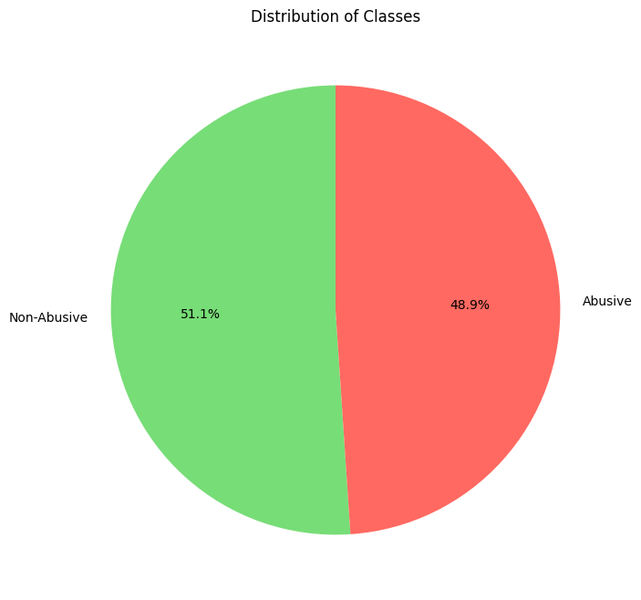
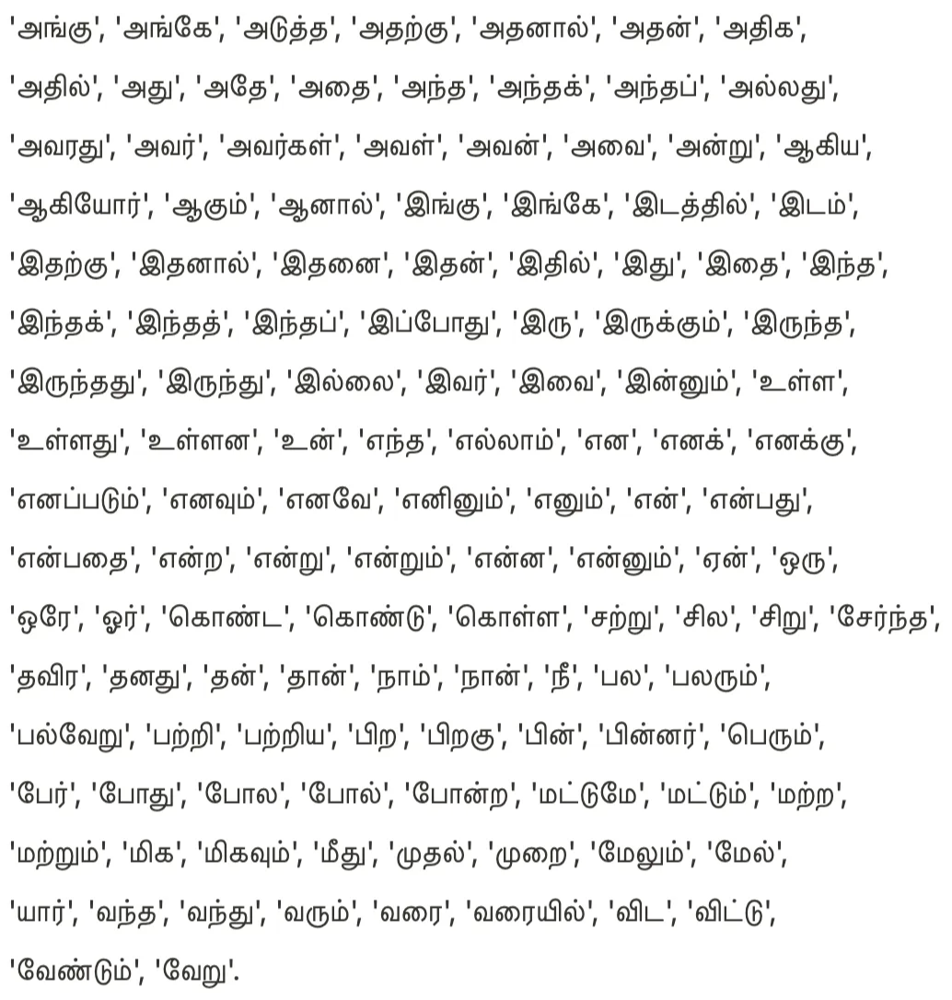

# Abusive Tamil Text Targeting Women on Social Media

**JAS@DravidianLangTech, NAACL 2025, ACL Anthology** · [Paper](https://aclanthology.org/2025.dravidianlangtech-1.6/) · [Notebook](WISE.ipynb)

B Saathvik, Janeshvar Sivakumar, Durairaj Thenmozhi
Sri Sivasubramaniya Nadar College of Engineering

> **Ranked 10th globally** in the shared task, with a test F1-score of 0.7687.

---

## Problem

Women are routinely targeted with derogatory comments on social media, and much of that abuse is written in regional languages that automated moderation systems handle poorly. Tamil, spoken by millions across India, Sri Lanka, Singapore, Malaysia and beyond, remains a low-resource language with little annotated data for this task.

This repository contains our submission to the shared task on **Abusive Tamil Text Targeting Women on Social Media** at DravidianLangTech@NAACL 2025. Given a Tamil YouTube comment, the goal is to classify it as **Abusive** or **Non-Abusive** towards women.

The training set contains 2,790 manually annotated comments and is close to balanced.

| Category | Count |
|---|---|
| Non-Abusive | 1,424 |
| Abusive | 1,366 |
| **Total** | **2,790** |

  
   <em>Figure 1: Class distribution of the training set</em>

## Methodology

**Preprocessing.** Comments are cleaned in four steps:

1. Remove numbers, hyperlinks, email addresses and emojis.
2. Lowercase English characters while preserving Tamil script.
3. Remove special characters and punctuation, and normalise whitespace.
4. Remove stop words using NLTK's English list and a manually curated Tamil list (Figure 2).

  
   <em>Figure 2: Tamil stop-words list</em>

**Model.** We fine-tune [`google/muril-base-cased`](https://huggingface.co/google/muril-base-cased) (Khanuja et al., 2021), a BERT model pre-trained on 17 Indian languages and their transliterated forms, using the Hugging Face Trainer API.

| Hyperparameter | Value |
|---|---|
| Epochs | 5 |
| Batch size | 16 |
| Learning rate | 2e-5 |
| Weight decay | 0.01 |
| Max sequence length | 128 |
| Checkpoint selection | Best validation F1 |

**Baselines.** Logistic Regression, SVM, LinearSVC and XGBoost are trained on TF-IDF features for comparison.

## Results

Evaluation on the validation set:

| Model | Precision | Recall | F1-Score | Accuracy |
|---|---|---|---|---|
| Logistic Regression | 0.68 | 0.68 | 0.68 | 0.68 |
| SVM | 0.70 | 0.70 | 0.70 | 0.70 |
| LinearSVC | 0.68 | 0.68 | 0.68 | 0.68 |
| XGBoost | 0.65 | 0.66 | 0.65 | 0.66 |
| **MuRIL** | **0.73** | **0.83** | **0.78** | **0.78** |

MuRIL outperforms every TF-IDF baseline, reaching **77.76% accuracy** and an **F1-score of 77.65%** on the validation set. On the hidden test set, the system achieved an **F1-score of 0.7687** and **ranked 10th globally** in the shared task.

The main limitation is the small dataset, which restricts generalisation to real-world comments. Data augmentation and larger annotated corpora are promising directions for future work.

## Usage

The full pipeline is in [`WISE.ipynb`](WISE.ipynb), written for Google Colab.
